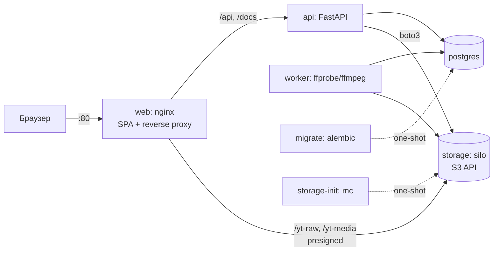

# Архитектура

## Цель

Копия YouTube, которая разворачивается на чистой Ubuntu 24.04 одной командой. Основа системы —
загрузка, хранение и раздача видео. Работают роли (пользователь, модератор, администратор)
и приватность: приватное видео видят только те, кому разрешил владелец.

## Критерии «работает правильно»

| # | Критерий | Чем проверяется |
|---|---|---|
| K1 | `sudo ./deploy.sh` на чистой Ubuntu 24.04 поднимает стек, `/api/health` = 200, загружены демо-данные | ВМ VirtualBox со снимком, CI |
| K2 | Браузер загружает файл напрямую в хранилище (multipart, с прогрессом), API не проксирует байты; битый файл получает статус `failed`, система не падает | pytest, smoke |
| K3 | Пока видео не обработано (`ready`), его нет в ленте и поиске | pytest |
| K4 | Приватное видео видят только владелец, пользователи из списка допуска, модераторы и админы. Это касается всех путей: лента, поиск, канал, плейлист, прямая ссылка, URL потока, комментарии | pytest, матрица доступа |
| K5 | Видео, скрытое модератором, видят только владелец (с пометкой) и модераторы/админы | pytest |
| K6 | Лайк идемпотентен, лайк и дизлайк взаимоисключающие, счётчики сходятся | pytest |
| K7 | Ни один ресурс не меняется без прав (IDOR), роль повышает только админ | pytest |
| K8 | Postgres и хранилище недоступны снаружи, секреты генерируются при деплое | CI, ревью |

## Компоненты



| Сервис | Образ | Назначение |
|---|---|---|
| `web` | nginx-unprivileged 1.27 + собранная SPA | Единственный публичный порт. Отдаёт SPA, проксирует API, Swagger и presigned-запросы к хранилищу, применяет rate limit и заголовки безопасности |
| `api` | python 3.12-slim | FastAPI, uvicorn (2 воркера). Слои: routes → services → repositories |
| `worker` | тот же код + ffmpeg | Обработка видео. Задачи берёт из таблицы в Postgres (`FOR UPDATE SKIP LOCKED`) |
| `postgres` | postgres 17-alpine | Метаданные, сессии, очередь задач |
| `storage` | pgsty/silo (форк MinIO) | Объекты: исходники, транскоды, превью |
| `migrate` | образ api | `alembic upgrade head` перед стартом api и worker |
| `storage-init` | образ silo (mc) | Закрытые бакеты и пользователь приложения с ограниченной политикой |

Порядок старта задаётся через `depends_on`: postgres/storage (healthy) → migrate/storage-init
(completed) → api/worker → web.

## Поток загрузки и просмотра

1. `POST /api/uploads`: API проверяет права и заявленный размер (не больше 2 ГБ), создаёт видео
   в статусе `uploading` и multipart upload в `yt-raw`, возвращает presigned URL для каждой части.
2. Браузер загружает части через PUT по presigned URL (через nginx, тот же origin, без CORS)
   и показывает прогресс.
3. `POST /api/uploads/{id}/complete`: API завершает multipart upload и в одной транзакции
   переводит видео в `processing` и ставит задачу в очередь.
4. Worker забирает задачу: ffprobe (реальный медиафайл, не длиннее 60 минут) → транскод в MP4
   360p и 720p (H.264/AAC, faststart) → кадр-превью → загрузка в `yt-media` → статус `ready`.
   При ошибке статус `failed` с причиной; предусмотрены повторы.
5. Просмотр: `GET /api/videos/{id}/stream` проверяет политику доступа и выдаёт presigned GET URL
   с коротким TTL. Плеер работает с Range-запросами (перемотка).

Подробности решений описаны в ADR: `docs/adr/`.

## Структура репозитория

```
backend/            FastAPI, worker, alembic, tests
  app/api/routes/   HTTP-слой
  app/services/     бизнес-логика, policies.py — единая политика доступа
  app/repositories/ SQL
  app/models/       SQLAlchemy-модели
  app/worker/       фоновая обработка
frontend/           React + Vite + TypeScript SPA
infra/nginx/        конфиг и Dockerfile web
infra/silo/         инициализация хранилища
scripts/            gen-env, seed, smoke
docs/               архитектура, БД, безопасность, ADR
.claude/            агентная обвязка (агенты, скиллы, хуки, настройки)
```
