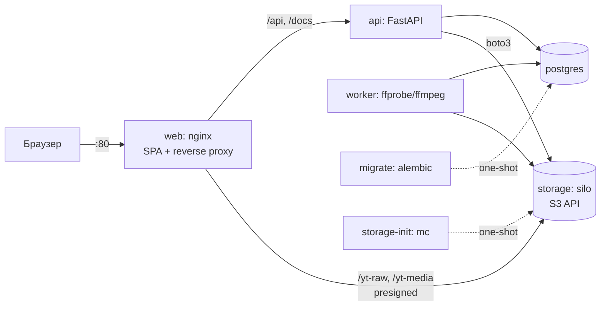

# Архитектура

## Цель

Копия YouTube, которая разворачивается на чистой Ubuntu 24.04 одной командой. Основа системы —
загрузка, хранение и раздача видео. Работают роли (пользователь, модератор, администратор)
и приватность: приватное видео видят только те, кому разрешил владелец.

## Критерии «работает правильно»

| # | Критерий | Чем проверяется |
|---|---|---|
| K1 | `sudo ./deploy.sh` на чистой Ubuntu 24.04 поднимает стек, `/api/health` = 200, загружены демо-данные | чистая Ubuntu 24.04: WSL `yt-clean` из снимка ([процедура](deploy-testing.md)), контрольно ВМ; CI — запуск стека |
| K2 | Браузер загружает файл напрямую в хранилище (multipart, с прогрессом), API не проксирует байты; битый файл получает статус `failed`, система не падает | pytest, smoke |
| K3 | Пока видео не обработано (`ready`), его нет в ленте и поиске | pytest |
| K4 | Приватное видео видят только владелец, пользователи из списка допуска, модераторы и админы. Это касается всех путей: лента, поиск, канал, плейлист, прямая ссылка, URL потока, комментарии | pytest, матрица доступа |
| K5 | Видео, скрытое модератором, видят только владелец (с пометкой) и модераторы/админы | pytest |
| K6 | Лайк идемпотентен, лайк и дизлайк взаимоисключающие, счётчики сходятся | pytest |
| K7 | Ни один ресурс не меняется без прав (IDOR), роль повышает только админ | pytest |
| K8 | Postgres и хранилище недоступны снаружи, секреты генерируются при деплое | CI, ревью |

## Компоненты



| Сервис | Образ | Назначение |
|---|---|---|
| `web` | nginx-unprivileged 1.27 + собранная SPA | Единственный публичный порт. Отдаёт SPA, проксирует API, Swagger и presigned-запросы к хранилищу, применяет rate limit и заголовки безопасности |
| `api` | python 3.12-slim | FastAPI, uvicorn (2 воркера). Слои: routes → services → repositories |
| `worker` | тот же код + ffmpeg | Обработка видео. Задачи берёт из таблицы в Postgres (`FOR UPDATE SKIP LOCKED`) |
| `postgres` | postgres 17-alpine | Метаданные, сессии, очередь задач |
| `storage` | pgsty/silo (форк MinIO) | Объекты: исходники, транскоды, превью |
| `migrate` | образ api | `alembic upgrade head` перед стартом api и worker |
| `storage-init` | образ silo (mc) | Закрытые бакеты и пользователь приложения с ограниченной политикой |

Порядок старта задаётся через `depends_on`: postgres/storage (healthy) → migrate/storage-init
(completed) → api/worker → web.

## Поток загрузки и просмотра

1. `POST /api/uploads`: API проверяет права, заявленный размер (не больше 2 ГБ) и лимит
   незавершённых загрузок (3 на пользователя). Создаёт видео в статусе `uploading` и multipart upload
   в `yt-raw`, возвращает presigned PUT на каждую часть (16 МиБ, длина части входит в подпись).
2. Браузер загружает части через PUT по presigned URL (через nginx, тот же origin, без CORS)
   и показывает прогресс.
3. `POST /api/uploads/{id}/complete`: API склеивает части, сверяет фактический размер с заявленным
   (при расхождении — `failed`), затем в одной транзакции переводит видео в `processing`,
   записывает исходник и ставит задачу в очередь. `DELETE /api/uploads/{id}` отменяет
   незавершённую загрузку.
4. Worker забирает задачу (`SKIP LOCKED`, lease, fencing-токен): ffprobe (реальный медиафайл
   из белого списка форматов и кодеков, не длиннее 60 минут, не больше 4K) → транскод в MP4
   360p и 720p (H.264/AAC, faststart, без метаданных исходника) → кадр-превью → загрузка
   в `yt-media` → одной транзакцией статус `ready` → исходник удаляется. Непригодный файл —
   `failed` с причиной без повторов; временный сбой — повтор с паузой (до 3 попыток).
5. Просмотр: `GET /api/videos/{id}/stream` проверяет политику доступа и выдаёт presigned GET URL
   всех доступных качеств (лучшее первым) и превью на 15 минут. Плеер работает с Range-запросами
   (перемотка) и при истечении ссылки запрашивает `/stream` заново.

## API просмотра

| Эндпоинт | Что отдаёт | Доступ |
|---|---|---|
| `GET /api/videos?q=&cursor=&limit=` | Лента главной, новые сверху; с `q` — поиск подстроки в названии без учёта регистра (`%`, `_`, `\` — буквально; `q` 1–100 символов, NUL → 422). Без ранжирования по релевантности (упрощение) | каталог: `ready ∧ public ∧ ok` (`listed_filter`), одинаково для всех, K3/K4 |
| `GET /api/videos/{id}` | Карточка; `state` (статус, видимость, модерация) — владельцу и staff | `can_view`, иначе 404 |
| `GET /api/videos/{id}/stream` | Ссылки на 360p/720p и превью, `expires_in` | `can_view`, иначе 404; не готово → 409 |
| `PATCH /api/videos/{id}` | Правка названия, описания, видимости; в ответе — карточка | владелец (`can_manage`); не может открыть → 404, может открыть, но не владелец → 403, аноним → 401 (ADR 0006, доп. 2) |
| `DELETE /api/videos/{id}` | Удалить видео в любом статусе: строки (каскад) и объекты хранилища после commit; 204 | как `PATCH`; занято дольше 5 с → 503 + `Retry-After` (ADR 0006, доп. 3) |
| `PUT /api/videos/{id}/reaction` `{kind}` / `DELETE …/reaction` | Лайк или дизлайк (взаимоисключающие, идемпотентно); в ответе — моя реакция и счётчики. В карточке — `my_reaction` | вход; `can_view`, иначе 404; не готово или скрыто модератором → 409 (`can_interact`, ADR 0006 доп. 4), обе проверки повторяются под блокировкой; занято → 503 (K6) |
| `POST /api/videos/{id}/view` | Засчитать просмотр (плеер — после нескольких секунд воспроизведения); 204. Без дедупликации (упрощение дня 5) | вход не нужен; `can_view`, иначе 404; не готово → 409; скрытое модератором — 204 без засчитывания; условия политики — в самом `UPDATE` (ADR 0006 доп. 4) |
| `GET /api/videos/{id}/comments?cursor=&limit=` | Комментарии, новые сверху (keyset); у каждого — канал автора и `can_delete`; staff — ещё `author_user_id` и `author_banned`. Комментарии забаненных видит только staff | вход не нужен; `can_view`, иначе 404 (под скрытым видео — владельцу и staff) |
| `POST /api/videos/{id}/comments` `{body}` | Комментарий (обычный текст, 1–2000 символов после обрезки, правила текста — ниже); 201. Счётчик — в той же транзакции | вход; `can_view` → 404; не готово или скрыто → 409 (`can_interact`); условия политики — в самом `UPDATE comments_count` (ADR 0006 доп. 5) |
| `DELETE /api/comments/{id}` | Удалить комментарий; 204 | вход; автор, владелец видео или staff (`can_delete_comment`; удаление staff — в журнал модерации); не виден → 404, виден без прав → 403 (ADR 0006 доп. 5, 6) |
| `POST /api/videos/{id}/reports` `{category, comment?}` | Жалоба: категория `spam`/`violence`/`adult`/`copyright`/`other`, пояснение до 500 (правила текста — ниже; без видимых символов — `null`); 201 — `{id, category, status, created_at}`, без автора | вход; `can_view` → 404; своё видео → 400; не готово или скрыто → 409; уже есть открытая жалоба → 409 (ADR 0006 доп. 6) |
| `GET /api/videos/{id}/access` | Список допуска (ник, дата), новые сверху; `max_entries` = 100 | как `PATCH` |
| `POST /api/videos/{id}/access` `{username}` | Выдать допуск по нику: 201 — выдан, 200 — уже был; нет пользователя → 404, себе → 400, лимит 100 → 409 | как `PATCH`; лимит — под блокировкой строки видео |
| `DELETE /api/videos/{id}/access/{user_id}` | Отозвать допуск; идемпотентно, 204 | как `PATCH` |
| `GET /api/channels/{handle}` | Карточка канала; `subscribers_count` и `subscribed` (я подписан; `null` — аноним). Кто подписан — не отдаётся | всем; канал забаненного (и его видео, плейлисты, подписка) — 404, кроме staff |
| `GET /api/channels/{handle}/videos` | Видео канала | каталог |
| `PUT /api/channels/{handle}/subscription` / `DELETE …/subscription` | Подписаться / отписаться (идемпотентно); в ответе `{subscribed, subscribers_count}` | вход; свой канал → 400; неизвестный → 404. Подписка не влияет на доступ к видео |
| `GET /api/me/subscriptions?cursor=&limit=` | Мои подписки: каналы, новые сверху (keyset по `created_at, channel_id`). Лента видео подписок — день 9 | вход; только свои (параметра «чей список» нет) |
| `GET /api/me/videos?cursor=&limit=` | «Мои видео»: свои видео в любом статусе со `state`, новые загрузки сверху (keyset по `created_at, id`) | вход; только свой канал (`owned_filter`), и для staff |
| `POST /api/playlists` `{title, description?, visibility}` | Создать плейлист (название 1–150, описание до 5000; правила текста — ниже); 201. Лимит 200 на канал → 409 | вход |
| `GET /api/playlists/{id}` | Карточка: название, описание, канал, `video_count` и превью — по видео, доступным зрителю; `visibility` — только владельцу; `can_manage` | `can_view_playlist`: public/unlisted — всем, private — только владельцу (staff тоже 404) |
| `GET /api/playlists/{id}/videos?cursor=&limit=` | Состав по порядку (keyset по `position`); недоступные зрителю видео не показываются; `state` — владельцу видео и staff | `can_view_playlist` → 404; видео — `visible_filter` текущего зрителя (K4) |
| `PATCH /api/playlists/{id}` / `DELETE /api/playlists/{id}` | Правка (хотя бы одно поле) / удаление (элементы каскадом, видео не затрагиваются) | владелец (`can_manage`); не может открыть → 404, может → 403, аноним → 401 |
| `PUT /api/playlists/{id}/videos/{video_id}` | Добавить **своё** видео (в любом статусе) в конец: 201, уже было — 200. Лимит 5000 → 409 | как `PATCH`; чужое видео: видит — 403, не видит — 404 |
| `DELETE /api/playlists/{id}/videos/{video_id}` | Убрать видео; идемпотентно, 204 | как `PATCH` |
| `GET /api/channels/{handle}/playlists?cursor=&limit=` | Плейлисты канала, новые сверху | только `public` (`listed_playlists_filter`), одинаково для всех |
| `GET /api/me/playlists?cursor=&limit=&video_id=` | Мои плейлисты со `visibility`; с `video_id` — `contains_video` (меню «Сохранить в плейлист») | вход; только свои |

### Модерация (staff: moderator и admin; аноним → 401, остальные → 403)

| Эндпоинт | Что делает |
|---|---|
| `GET /api/admin/reports?status=open\|resolved\|dismissed&cursor=&limit=` | Очередь жалоб, новые сверху (keyset): категория, пояснение, кто пожаловался, снимок (название, канал) и текущее состояние видео (`null` — удалено). Модератору жалобы на его собственные видео не показываются |
| `PUT /api/admin/videos/{id}/moderation` `{state, reason}` | `hidden` (причина обязательна, её видит владелец; открытые жалобы → `resolved`) или `ok` (причина снимается, жалобы не открываются); в ответе — `closed_reports`. Повтор — без изменений |
| `POST /api/admin/reports/{id}/dismiss` `{reason?}` | Отклонить открытую жалобу; закрытая → 409 |
| `PUT /api/admin/users/{id}/ban` `{reason}` / `DELETE …/ban` | Бан (причина 1–500) и разбан. Модератор — только user; админ — user и moderator; админа и себя — нельзя; бан админа модератор не снимает — все запреты 403. Повтор — 409. В ответе — без email: ник, роль, причина, кто забанил, число пересчитанных видео и каналов |

Модератор не модерирует своё видео (скрытие, возврат, отклонение жалобы — 403); админ может,
с пометкой `own_video` в журнале (ADR 0006 доп. 6).
В очереди жалоб у видео — `owner_id` и `owner_banned`, в комментариях для staff — `author_user_id`
и `author_banned`: из них staff банит. Контент забаненного видит только staff, его реакции,
комментарии и подписки исключаются из счётчиков (ADR 0006 доп. 8). Смена роли
(`PATCH /api/admin/users/{id}`, только админ) пишется в журнал; забаненному роль не меняется (409).
Действия staff (скрытие, возврат, отклонение, удаление чужого комментария) пишутся
в `moderation_log` со снимком цели, как и бан, разбан и смена роли. Порядок блокировок
«видео → жалобы» — ADR 0006 доп. 6, бана — доп. 8.

Списки — keyset-пагинация по `(момент времени, id)` — `published_at` в каталоге, `created_at`
в «Моих видео», плейлистах канала и «Моих плейлистах»; состав плейлиста — по `position` —
с непрозрачным курсором (`next_cursor = null`
на последней странице), `limit` 1–50. Все ответы — `Cache-Control: no-store`: в них подписанные
ссылки. Правила доступа — ADR 0006 и дополнения 1–8 (плейлисты — доп. 7, бан — доп. 8).

**Правила текста** (комментарий, название и описание видео и плейлиста, пояснение к жалобе, причины модерации и бана; `app/schemas/text.py`): управляющие символы C0/C1, кроме табуляции и переводов строки, — 422 (в названиях видео и плейлистов табуляция и переводы строк
заменяются пробелом); bidi-символы U+202A–U+202E, U+2066–U+2069 вырезаются до проверки длины; текст без видимых символов — 422 в обязательном поле, пустое значение в необязательном. Подробно — `docs/security.md`.

Подробности решений описаны в ADR: `docs/adr/`.

## Периодические задачи worker (maintenance)

Раз в `WORKER_MAINTENANCE_SECONDS` (5 мин):

| Что | Правило |
|---|---|
| Задачи упавших worker-ов | lease истёк → обратно в очередь или `failed` по лимиту попыток |
| Сессии | истёкшие удаляются |
| Брошенные загрузки | `uploading` дольше `STALE_UPLOAD_HOURS` (24 ч) — строка, multipart и объект |
| Сироты `yt-media` | префиксы `videos/{id}/{token}/` без ссылок из `video_files`, старше `ORPHAN_MEDIA_MINUTES` |
| Сироты `yt-raw` | `raw/{id}/source` и multipart старше `ORPHAN_MEDIA_MINUTES`, если видео нет или оно `ready`/`failed`. Видео в `uploading`/`processing` не трогается при любом возрасте: долгая загрузка не обрывается |

## Структура репозитория

```
backend/            FastAPI, worker, alembic, tests
  app/api/routes/   HTTP-слой
  app/services/     бизнес-логика, policies.py — единая политика доступа
  app/repositories/ SQL
  app/models/       SQLAlchemy-модели
  app/worker/       фоновая обработка
frontend/           React + Vite + TypeScript SPA
infra/nginx/        конфиг и Dockerfile web
infra/silo/         инициализация хранилища
scripts/            gen-env, seed, smoke
docs/               архитектура, БД, безопасность, ADR
.claude/            агентная обвязка (агенты, скиллы, хуки, настройки)
```
