# База данных

PostgreSQL 17. Схема ведётся миграциями Alembic (`backend/alembic/versions/`), модели лежат
в `backend/app/models/`. В БД хранятся только метаданные. Сами файлы видео, транскоды
и превью лежат в объектном хранилище, а таблица `video_files` хранит их бакет и ключ.

Схема наращивается по мере появления функций:

| Миграция | Таблицы | День |
|---|---|---|
| `c7a041934a27` initial schema | users, channels, sessions, videos, video_files, video_access, jobs | 2 |
| `d39fd7e9e8b8` ix_videos_channel_created | индекс «Моих видео» | 4 |
| `feae87d73a60` reactions | reactions (лайк/дизлайк) | 5 |
| `685d115152a1` comments | comments (плоские, без правки) | 5 |
| `6507f3ac93de` subscriptions | subscriptions (подписки на каналы) | 5 |
| — | playlists, playlist_items | 6 |
| `3c6f18f885c5` reports and moderation log | reports (жалобы со снимком видео), moderation_log (журнал staff) | 6 |
| — | watch_history | 8–9 |

## ER-диаграмма (текущая)

```mermaid
erDiagram
    users ||--|| channels : "владеет (1:1)"
    users ||--o{ sessions : "входы"
    channels ||--o{ videos : "публикует"
    videos ||--o{ video_files : "объекты в хранилище"
    videos ||--o{ video_access : "список допуска"
    users ||--o{ video_access : "допущен к"
    videos ||--o{ jobs : "обработка"
    videos ||--o{ reactions : "лайки и дизлайки"
    users ||--o{ reactions : "реагирует"
    videos ||--o{ comments : "комментарии"
    users ||--o{ comments : "пишет"
    channels ||--o{ subscriptions : "подписчики"
    users ||--o{ subscriptions : "подписан на"
    videos |o--o{ reports : "жалобы (SET NULL при удалении)"
    users |o--o{ reports : "жалуется"
    users |o--o{ moderation_log : "действует (staff)"

    users {
        uuid id PK
        citext email UK
        citext username UK
        varchar password_hash "argon2id"
        user_role role "user | moderator | admin"
        bool is_banned
        text banned_reason
        timestamptz created_at
        timestamptz updated_at
    }
    channels {
        uuid id PK
        uuid owner_id FK,UK
        citext handle UK
        varchar title
        text description
        varchar avatar_key "ключ в хранилище"
        varchar banner_key
        int subscribers_count "денормализация"
    }
    subscriptions {
        uuid channel_id PK,FK
        uuid user_id PK,FK
        timestamptz created_at
    }
    sessions {
        uuid id PK
        uuid user_id FK
        bytea token_hash UK "SHA-256, 32 байта"
        timestamptz expires_at
        timestamptz last_seen_at
        inet ip
        varchar user_agent
    }
    videos {
        uuid id PK
        uuid channel_id FK
        varchar title
        text description
        video_visibility visibility "public | unlisted | private"
        video_status status "uploading | processing | ready | failed"
        moderation_state moderation "ok | hidden"
        text moderation_reason
        text failure_reason
        bigint size_bytes "до 2 ГБ"
        int duration_seconds "до 60 мин (CHECK + ffprobe в worker)"
        varchar upload_id "S3 multipart"
        bigint views_count
        int likes_count
        int dislikes_count
        int comments_count
        timestamptz published_at "первая публикация: ready и не private"
    }
    video_files {
        uuid id PK
        uuid video_id FK
        video_file_kind kind "original | mp4_360 | mp4_720 | thumbnail"
        varchar bucket
        varchar s3_key
        varchar mime
        bigint size_bytes
        int width
        int height
    }
    video_access {
        uuid video_id PK,FK
        uuid user_id PK,FK
        timestamptz granted_at
    }
    reactions {
        uuid video_id PK,FK
        uuid user_id PK,FK
        reaction_kind kind "like | dislike"
        timestamptz created_at
    }
    comments {
        uuid id PK
        uuid video_id FK
        uuid author_id FK
        text body "1–2000 символов после btrim, обычный текст"
        timestamptz created_at
    }
    reports {
        uuid id PK
        uuid video_id FK "NULL — видео удалено"
        uuid reporter_id FK "только staff видит"
        report_category category "spam | violence | adult | copyright | other"
        text comment "до 500, необязательно"
        varchar video_title "снимок"
        varchar channel_handle "снимок"
        report_status status "open | resolved | dismissed"
        uuid resolved_by FK
        timestamptz resolved_at
        timestamptz created_at
    }
    moderation_log {
        uuid id PK
        uuid actor_id FK "staff; NULL — удалён"
        moderation_action action "video_hide | video_unhide | comment_delete | report_dismiss | user_ban | user_unban"
        uuid target_id "без FK: запись переживает цель"
        text reason "до 500"
        jsonb details "снимок цели"
        timestamptz created_at
    }
    jobs {
        uuid id PK
        job_type type "process_video"
        uuid video_id FK
        job_status status "queued | running | done | failed"
        int attempts
        int max_attempts
        timestamptz run_after
        uuid locked_by "fencing-токен захвата"
        timestamptz locked_until "lease worker-а"
        text last_error
    }
```

## Решения по схеме

**Идентификаторы.** UUID (`gen_random_uuid()`) во всех публичных сущностях: ID видео попадает
в URL, и последовательные номера позволили бы перебором находить unlisted-видео.

**Регистр.** `email`, `username`, `handle` имеют тип `citext`. Уникальность без учёта регистра
обеспечивает сама БД, поэтому `Alice@x.ru` и `alice@x.ru` — один пользователь даже при гонке
двух регистраций.

**Три независимых признака видео** (ADR 0006): `visibility` меняет владелец, `status` — система,
`moderation` — модератор. Скрытие модератором не трогает выбор владельца, а снятие скрытия
возвращает видео в прежнее состояние.

**Дата публикации** (`published_at`). Ставится в момент первой публикации: видео готово
и его видимость не `private`. Потом не меняется. Видео, загруженное приватным месяц назад
и открытое сегодня, попадёт в ленту как новое (как на YouTube). Повторная обработка
и скрытие модератором дату не трогают. Правило одно для worker и правки владельцем —
`app/services/publication.publish_if_due`. Следствия, принятые сознательно:
- `unlisted` — тоже публикация: видео, загруженное unlisted в январе и открытое для всех
  в марте, встанет в ленту с январской датой;
- модерация в правило не входит: если владелец откроет скрытое видео, дата поставится
  сразу, а после снятия скрытия (день 6) видео вернётся в ленту с этой датой.

**Очередь задач.** Контракт (захват, fencing, возврат по истёкшему lease, исчерпание попыток)
описан в docstring модели `app/models/job.py`. Fencing-токен `locked_by` выдаётся заново
при каждом захвате. Завершить задачу можно только с текущим токеном, поэтому worker с истёкшим
lease не перезапишет результат того, кто перехватил задачу.

**Денормализованные счётчики** (`views_count`, `likes_count`, `subscribers_count` и т.п.).
Лента и карточки показывают их без `COUNT(*)` по большим таблицам. Счётчики обновляются в той же
транзакции, что и исходное действие. CHECK `>= 0` ловит ошибку в коде, из-за которой счётчик ушёл бы в минус.
Реакции: одна строка на пару (видео, пользователь) — лайк и дизлайк взаимоисключающие;
все изменения реакций одного видео сериализуются блокировкой строки видео (`FOR NO KEY UPDATE`),
прежняя реакция читается под ней, счётчики меняются на разницу «было → стало» (K6).
Комментарии: добавление — атомарный `UPDATE comments_count + 1` с условиями политики в самом
запросе (как у просмотров), затем `INSERT` в той же транзакции; удаление — блокировка строки
видео, затем `DELETE … RETURNING`, и счётчик −1, только если строку удалил этот запрос.
Подписки: `INSERT … ON CONFLICT DO NOTHING RETURNING` / `DELETE … RETURNING` говорят, изменил
ли состояние именно этот запрос, и только тогда `subscribers_count` меняется атомарным
`UPDATE … + delta` — без блокировки строки канала (параллельные запросы одного пользователя
упорядочивает PK подписки). Порядок блокировок «подписка → канал».
Изменение счётчиков не сдвигает `videos.updated_at` (время правки метаданных).
**Известный дрейф (день 6):** каскад при удалении пользователя (`users → reactions`,
`users → comments`, `users → subscriptions`) счётчики чужих видео и каналов не уменьшает.
Путь удаления пользователя (и бан/разбан) на дне 6 обязан пересчитать `likes_count`,
`dislikes_count`, `comments_count` затронутых видео и `subscribers_count` каналов.
**Известное ограничение:** реакции (а с шагов 2 и 5 — комментарии и просмотры) популярного
видео сериализуются на одной строке `videos`; при очереди дольше `lock_timeout` — 503.
То же для `subscribers_count` популярного канала (строка `channels`).
Для масштаба тестового задания приемлемо; дальше — отдельная таблица счётчиков.

**Ограничения целостности в БД, а не только в коде:**

| Ограничение | Зачем |
|---|---|
| `ck_videos_published_only_if_ready` | `published_at` может быть только у готового видео |
| `ck_videos_duration_max_60min` | Лимит ТЗ 60 минут на уровне БД; основную проверку делает ffprobe в worker |
| `ck_videos_size_limit_2gb`, `ck_videos_title_length`, `ck_videos_description_length` | Лимиты ТЗ и формы загрузки |
| `ck_users_username_format`, `ck_channels_handle_format` | Латиница, цифры, `_` (у handle ещё `.` и `-`), 3–30 символов. Ник попадает в URL канала |
| `uq_channels_owner_id` | Ровно один канал на пользователя |
| `ck_sessions_token_hash_sha256` | В БД нельзя случайно записать сам токен вместо хэша |
| `uq_jobs_active_per_video` (частичный уникальный индекс) | На видео не больше одной активной задачи обработки. Повторный `complete` загрузки не создаст дубль; после `failed` новая задача разрешена |
| `ck_jobs_attempts_range`, `ck_jobs_max_attempts_range` | Число попыток не превышает лимит, лимит от 1 до 10 |
| `ck_jobs_lease_iff_running` | Статус `running` тогда и только тогда, когда есть fencing-токен `locked_by` и срок `locked_until` |
| `ck_comments_body_length` | Комментарий 1–2000 символов после обрезки пробелов: пустой из одних пробелов не сохранится и в обход API |
| `uq_reports_open_video_reporter` (частичный уникальный индекс, `WHERE status = 'open'`) | Одна открытая жалоба пользователя на видео: параллельные дубли отсекает БД. После закрытия жалобы можно пожаловаться снова |
| `ck_reports_resolved_consistent` | Жалоба открыта тогда и только тогда, когда у неё нет `resolved_at` |
| `ck_reports_comment_length`, `ck_moderation_log_reason_length` | Текст жалобы и причина действия — до 500 символов |

**Каскады.** Удаление пользователя удаляет его канал, видео, сессии, записи допуска и задачи
(`ON DELETE CASCADE`). В ORM у связей `passive_deletes=True`: каскад выполняет БД. Без этого
ORM пытался бы обнулить внешний ключ и упирался в NOT NULL; ошибку поймал тест
`test_deleting_user_cascades`. Удаление видео каскадом удаляет `video_files`, `video_access`,
`jobs`, `reactions` и `comments`; блокировки берутся в порядке «задачи → видео →
комментарии» (ADR 0006, доп. 3 и 5): удаление комментария тоже сначала блокирует видео.
Жалобы при удалении видео не удаляются: `reports.video_id` → `SET NULL`, снимок (название,
канал) остаётся в жалобе. Порядок «видео → жалобы» — и при скрытии, и при удалении видео,
и при создании жалобы (ADR 0006 доп. 6). `moderation_log` ссылается на цель без внешнего
ключа: журнал переживает удаление видео, комментария, пользователя; удаление staff обнуляет
`actor_id` и `resolved_by` (`SET NULL`) — без индекса: удаление staff редкое (день 9).
Объекты в хранилище при удалении видео удаляет приложение (после коммита), так как БД
о хранилище не знает; остатки при сбое хранилища убирает maintenance.

**`lock_timeout`** задаётся на соединение (`server_settings` движка, `DB_LOCK_TIMEOUT_MS`):
API — 5 с, worker — 30 с.

**Связи в ORM** — `lazy="raise"`. Случайное обращение к незагруженной связи в async-коде
сразу даёт явную ошибку, а не скрытый запрос с `MissingGreenlet` в проде. Связи загружаются
явно (`selectinload`). `eager_defaults=True` в базовом классе: `updated_at` и другие серверные
значения приходят через `RETURNING` и на `UPDATE`.

## Индексы под запросы

| Запрос | Индекс |
|---|---|
| Лента главной: готовые публичные не скрытые, новые сверху | `ix_videos_feed` — частичный по `(published_at DESC, id DESC)` (`id` — tie-breaker для keyset-пагинации) с `WHERE status='ready' AND visibility='public' AND moderation='ok'`. Скрытые и приватные в индекс не попадают |
| Видео канала | `ix_videos_channel_published (channel_id, published_at DESC, id DESC)` |
| «Мои видео»: все видео своего канала в любом статусе, новые загрузки сверху | `ix_videos_channel_created (channel_id, created_at DESC, id DESC)`; условие — равенство со скалярным подзапросом канала (`policies.owned_filter`), порядок берётся из индекса без сортировки (тест плана) |
| Поиск по названию (`ILIKE '%…%' ESCAPE '\'`, ввод экранируется в `repositories/videos.escape_like`) | `ix_videos_title_trgm` — GIN `gin_trgm_ops` или `ix_videos_feed` в порядке выдачи с фильтром — выбирает planner (тест: без Seq Scan). Запросы короче 3 символов триграммы не ускоряют: идёт `ix_videos_feed` до `limit` — на объёме задания приемлемо |
| Сессия по токену из cookie | `uq_sessions_token_hash` |
| Очистка просроченных сессий | `ix_sessions_expires_at` |
| Следующая задача для worker | `ix_jobs_queued (run_after) WHERE status='queued'` |
| Задачи с истёкшим lease (упавший worker) | `ix_jobs_running_lease (locked_until) WHERE status='running'` |
| «Понравившиеся» (день 9), каскад при удалении пользователя | `ix_reactions_user_kind_created (user_id, kind, created_at DESC)` (PK начинается с `video_id`); смена реакции обновляет `created_at` |
| Комментарии видео, новые сверху (keyset по `(created_at, id)`) | `ix_comments_video_created (video_id, created_at DESC, id DESC)` |
| «Мои подписки», новые сверху (keyset по `(created_at, channel_id)`); лента подписок (день 9); каскад при удалении пользователя | `ix_subscriptions_user_created (user_id, created_at DESC, channel_id DESC)` (PK начинается с `channel_id` — он же для каскада при удалении канала) |
| Каскад при удалении пользователя → его комментарии | `ix_comments_author (author_id)` |
| «Доступные мне» приватные видео, новые выдачи сверху | `ix_video_access_user_granted (user_id, granted_at DESC)` (PK начинается с `video_id`) |
| Каскадное удаление видео → задачи (done/failed копятся) | `ix_jobs_video_id` |
| Очередь модерации: жалобы по статусу, новые сверху (keyset по `(created_at, id)`) | `ix_reports_status_created (status, created_at DESC, id DESC)` |
| Открытые жалобы видео: закрытие при скрытии | `uq_reports_open_video_reporter (video_id, reporter_id) WHERE status = 'open'` |
| `SET NULL` при удалении видео — все его жалобы, и закрытые тоже | `ix_reports_video (video_id)` |
| `SET NULL` при удалении пользователя (день 9) | `ix_reports_reporter (reporter_id)` |
| История действий над целью (видео, пользователь), новые сверху | `ix_moderation_log_target_created (target_id, created_at DESC)` |

## Отложено (зафиксировано по итогам ревью схемы)

| Пункт | Когда |
|---|---|
| Удаление видео или пользователя: сначала собрать ключи объектов из `video_files`, затем удалить строки и объекты в хранилище. Каскад в БД ключи теряет. Worker должен корректно обрабатывать удаление видео во время транскода и удалять уже загруженные объекты | день 3 (worker), день 6 (модерация, удаление) |
| Очередь: возврат задач с истёкшим lease двумя UPDATE (`attempts < max_attempts` → queued, иначе → failed) и тесты на fencing | день 3 (worker) |

## Роли

| Роль | Права | Кто использует |
|---|---|---|
| `POSTGRES_USER` (`yt`) | суперпользователь, владелец схемы | только `migrate` (Alembic) и подготовка тестовой БД |
| `APP_DB_USER` (`yt_app`) | `SELECT/INSERT/UPDATE/DELETE` на таблицы, `USAGE` на последовательности; без CREATE и TRUNCATE | api, worker, tests |

Роль приложения создаётся и обновляется идемпотентно в `backend/app/db_bootstrap.py`
(сервис `migrate` вызывает его перед `alembic upgrade head`). На таблицы, которые создадут будущие
миграции, права выдаются автоматически через `ALTER DEFAULT PRIVILEGES`. Тест
`test_app_role_cannot_change_schema` проверяет, что DDL, `TRUNCATE` и `COPY … TO PROGRAM`
этой роли запрещены.

## Базы

- `yt` — рабочая.
- `yt_test` — автотесты. На каждый запуск пересоздаётся, миграции проходят цикл
  `upgrade → downgrade → upgrade`, после каждого теста таблицы очищаются (`tests/conftest.py`).

## Миграции: порядок работы

Описан в скилле `.claude/skills/db-migration/SKILL.md`. Коротко: сначала autogenerate, затем ручная
вычитка. Расширения и `DROP TYPE` для ENUM autogenerate не создаёт, их нужно дописать. Затем
`alembic check`: модели и миграции не должны расходиться.
